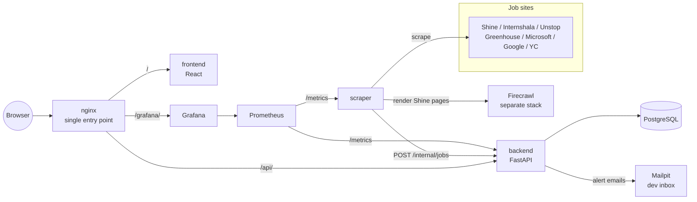

# Job Aggregator Platform: Project Documentation

**Repository:** <https://github.com/Haarish-Ahmad/Job-Aggregator-Platform>

## 1. What the project does

Job Aggregator Platform collects off-campus jobs and internships for students into one place. It scrapes job boards and
company career pages, keeps only software roles a student can apply for, and matches each posting to the student's skills.

| User | What they can do |
|---|---|
| **Students** | Register, search and filter jobs, see matches ranked by skills, turn on email alerts |
| **Placement cell (admin)** | See skills in demand, the skill gap between students and the market, hiring patterns, and how well the curriculum covers what companies ask for |

### Main features

- **Job collection** from 7 sources: Shine, Internshala, Unstop, Greenhouse, Microsoft, Google and Y Combinator.
- **Relevance filter:** keeps software roles open to undergraduates, and drops senior, PhD-only and non-software roles.
- **Deduplication and freshness:** a posting is stored once, updated if it changes, and marked inactive after 14 days unseen.
- **Skill matching:** eligibility checks (deadline, CGPA, branch, graduation year) plus a score: the share of a job's skills the student has.
- **Email alerts:** a digest of new matches scoring 60% or more, for students who opt in.
- **Analytics:** skills in demand, skill gap, company hiring patterns, curriculum alignment.
- **Monitoring:** Prometheus and Grafana dashboards for the API and the scraper.

## 2. How it works



### The data flow

1. **Scrape.** Every 12 hours the scraper visits each configured source. It respects `robots.txt` and waits between requests.
2. **Clean and filter.** Each posting is converted to plain text, then checked by the relevance filter.
3. **Find skills.** The scraper uses the source's own skill tags. If a source lists only requirement sentences, a keyword search of the text finds skills from a fixed list.
4. **Send to the backend.** Records go in batches to `POST /internal/jobs`, protected by a shared token. The backend answers per record: inserted, updated, unchanged or rejected. One bad record never fails the batch.
5. **Keep it fresh.** After each cycle, postings unseen for 14 days are marked inactive.
6. **Alert.** Students who opted in receive one email listing their new matches.
7. **Serve.** Students use the website, and the placement cell reads the analytics.

### Technology

| Part | Technology |
|---|---|
| Frontend | React, TypeScript, Vite |
| Backend | Python, FastAPI, SQLAlchemy, Alembic |
| Database | PostgreSQL 16 |
| Scraper | Python, httpx, BeautifulSoup, Firecrawl (for Shine) |
| Web entry point | nginx |
| Monitoring | Prometheus, Grafana |
| Containers | Docker, Docker Compose |
| CI/CD | GitHub Actions, GitHub Container Registry (GHCR) |

### Services

| Service | Role | Address |
|---|---|---|
| `nginx` | Single entry point | `http://localhost/` |
| `frontend` | The website | through nginx |
| `backend` | The API | `/api/`, docs at `/api/docs` |
| `db` | PostgreSQL database | internal |
| `scraper` | Scheduled scraping | internal |
| `prometheus` | Stores metrics | `http://localhost:9090` (this machine only) |
| `grafana` | Dashboards | `/grafana/` |
| `mailpit` | Catches emails in development | `http://localhost:8025` (this machine only) |

## 3. How to run it

### Requirements

- Docker with Compose v2.24 or newer.
- **Firecrawl**, only for the Shine source. Self-host it from <https://github.com/firecrawl/firecrawl> so that it answers on port 3002. The other sources work without it.

### Option A: build from source

```bash
git clone https://github.com/Haarish-Ahmad/Job-Aggregator-Platform.git
cd Job-Aggregator-Platform
cp .env.example .env
```

Fill in the required values in `.env`. You can generate each one with
`python3 -c "import secrets; print(secrets.token_hex(24))"`:

```
POSTGRES_PASSWORD=...     # letters and digits only
SECRET_KEY=...
INGEST_TOKEN=...
```

Then start everything:

```bash
docker compose up -d --build
docker compose ps            # wait until every service is "healthy"
```

| Open | What |
|---|---|
| <http://<server_ip> | The website. The first scrape fills the job list within minutes |
| <http://<server_ip>/grafana/> | Dashboards (login `admin` / `admin` by default) |
| <http://<server_ip>:8025/> | Mailpit inbox for alert emails |

Stop it with `docker compose down`. Adding `-v` also deletes the data.

### Option B: run the published images

The project publishes its images to **GitHub Container Registry (GHCR)**, not Docker Hub. Docker Hub is used only for the
official images the stack is built on, such as PostgreSQL, Prometheus, Grafana and Mailpit.

| Image | Name |
|---|---|
| Backend | `ghcr.io/haarish-ahmad/job-aggregator-platform-backend` |
| Scraper | `ghcr.io/haarish-ahmad/job-aggregator-platform-scraper` |
| Frontend | `ghcr.io/haarish-ahmad/job-aggregator-platform-frontend` |
| nginx | `ghcr.io/haarish-ahmad/job-aggregator-platform-nginx` |

You need the repository's `docker-compose.yml`, `docker-compose.prod.yml`, `monitoring/` folder and a `.env`. Then:

```bash
docker compose -f docker-compose.yml -f docker-compose.prod.yml pull
docker compose -f docker-compose.yml -f docker-compose.prod.yml up -d
```

`IMAGE_TAG` in `.env` chooses the version: `latest`, a commit such as `sha-1a2b3c4`, or a release such as `1.2.3`.

### How images are published

Publishing is automatic. On a push to `main` or a version tag such as `v1.2.3`, the Release workflow builds the four images
and uploads them to GHCR, using GitHub's built-in token.

| Trigger | Image tags |
|---|---|
| Push to `main` | `latest` and `sha-<commit>` |
| Version tag `v1.2.3` | `1.2.3` and `sha-<commit>` |

### Deploying to a server

The `server-setup/` folder turns a Linux machine into the server with one command, `bash setup.sh`. After that, every merge
to `main` builds the images and deploys them through a GitHub Actions runner on that machine. See
[`server-setup/README.md`](../server-setup/README.md).

## 4. Monitoring and performance

### What is monitored

Prometheus collects metrics from the backend and scraper every 15 seconds and keeps 15 days of history. Grafana shows them
on two dashboards:

- **App health:** API status, requests per second, server error rate, response times, active jobs, students, records received and alert emails.
- **Scraper:** status, jobs saved and failed, records sent to and refused by the API, pages fetched, run time per source and time since the last success.

### Measured results

Measured on the development machine (7.6 GB of RAM) with the stack running.

**API, over a 2.8-hour window**

| Metric | Value |
|---|---|
| Requests | 538 |
| Server errors (5xx) | 0 |
| Response time | about 5 ms |
| Response time, p95 | about 10 ms |
| Response time, p99 | about 290 ms |

Traffic in this window was light and mostly health checks. These numbers show normal idle behaviour, not capacity.

**Scraper, average time for one source**

| Source | Time |
|---|---|
| Internshala | about 23 seconds |
| Unstop | about 48 seconds |
| Shine | about 15 minutes (each page is rendered by Firecrawl) |

**Data collected:** 1,507 active postings: Internshala 812, Shine 387, Unstop 307, Microsoft 1.

**Memory used by the stack:** about 710 MB in total, with Grafana the largest at about 257 MB. Firecrawl runs separately and
isn't included. It needs several GB more, so a server should have about 8 GB of RAM or more.

**Image sizes:** backend 299 MB, scraper 221 MB, frontend 74 MB, nginx 74 MB.


## 5. Testing

### Automated tests

Results from the latest passing CI run:

| Tests | Tool | Count | What they check |
|---|---|---|---|
| Backend | pytest with a real PostgreSQL | 158 passed, 98% code coverage | API routes, including all 42 cases ; ingest, alerts, analytics, migrations |
| Scraper | pytest with saved web pages | 216 passed | Each source's parser, the filter, skill search, push, scheduling, storage |
| Integration | pytest with a real PostgreSQL | 7 passed | The real scraper feeding the real backend, with results read back through the API |
| Frontend | Vitest | 69 passed | Pages and components, including filters, login, job detail and analytics |
| Smoke test | `scripts/smoke.sh` | 35 passed | The whole running stack |

### How it was tested

**Static checks.** ruff (Python mistakes), mypy (Python types), ESLint and TypeScript (frontend), and ShellCheck (shell
scripts) all run in CI.

**Saved pages instead of live sites.** Scraper tests use real pages saved in `scraper/fixtures/`, so they are fast and
repeatable, and they don't send traffic to the job sites.

**Real database.** Backend and integration tests use a real PostgreSQL. Migrations are applied to an empty database, and
`alembic check` confirms they match the code's models.

**Whole-stack smoke test.** The script starts a separate copy of the stack with a mock Firecrawl, then checks:

- every container is healthy,
- nginx routing and security headers work,
- private endpoints are blocked,
- sign-in works,
- a scrape run twice creates no duplicates,
- an alert email arrives,
- Prometheus and Grafana work.

**Configuration checks.** CI confirms every setting is documented in `.env.example`, the compose files are valid and refuse
to start without secrets, and no Windows line endings are present.

**Deployment scripts.** `deploy.sh` was tested through a temporary local registry. Data survived a new version, old images
were removed, and a version that doesn't exist failed while the site stayed up. `setup.sh` was tested on a clean Ubuntu
container.

### The CI pipeline

Every pull request and branch push runs these jobs in order. A later stage starts only if the earlier ones pass.

1. Backend, Scraper, Integration, Frontend and Config checks, in parallel.
2. All four Docker images are built.
3. The smoke test runs on the whole stack.

## 7. Repository layout

```
backend/        FastAPI app, migrations, curriculum.yaml, tests
scraper/        Source adapters, filter, skill search, tests, saved pages
frontend/       React app and tests
infra/nginx/    Web entry point configuration
monitoring/     Prometheus settings and Grafana dashboards
tests/          Scraper-to-backend integration tests
scripts/        Smoke test and configuration checks
server-setup/   One-command server setup and the deploy script
.github/        CI and Release workflows
```

## 8. Team contributions

| Member | GitHub | Contributions |
|---|---|---|
| Haarish Ahmad | [Haarish-Ahmad](https://github.com/Haarish-Ahmad) | CI/CD pipeline and Server Setup |
| Sai Chaithanyia P | [chay123-crypto](https://github.com/chay123-crypto) | Backend |
| Aadithyaa E | [AadithyaaE](https://github.com/AadithyaaE) | Frontend |
| Anurag | [anuragg-subramaniyan-07](https://github.com/anuragg-subramaniyan-07) | Scaper |
| Valan | [ValanEz](https://github.com/ValanEz) | infra |
